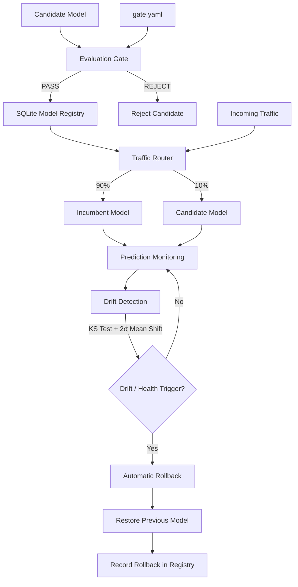

<div align="center">

# 🚀 Production ML Platform

### A Production-Grade Framework for Model Promotion, Serving, Monitoring & Rollback

**From model experimentation to reliable production deployment.**

[](https://github.com/adnanphp/production-ml-platform)


[Architecture](#-architecture) •
[Features](#-key-capabilities) •
[Quick Start](#-quick-start) •
[Testing](#-testing) •
[Design](#-design-decisions)

</div>

---

## 🎯 Overview

A model is not production-ready simply because it achieves a high score on a test set.

It is production-ready when the infrastructure around it can **evaluate, promote, serve, monitor, and safely replace it when something goes wrong.**

This project implements a lightweight production ML platform that addresses four fundamental engineering questions:

| Challenge | Solution | Implementation |
|---|---|---|
| Is a candidate model good enough? | Evaluation gate | Recall, ECE, latency and margin constraints |
| Can deployment decisions be reproduced? | Model registry | SQLite, model hashes, thresholds and rule versions |
| Is the running model still reliable? | Drift detection | Per-feature KS tests and 2σ mean-shift guard |
| Can a bad deployment be reversed? | Automatic rollback | Latency, error-rate and drift-based triggers |

The objective is to demonstrate the engineering infrastructure required to operate ML models reliably beyond offline evaluation.

---

## 🏗️ Architecture

The platform follows a controlled model lifecycle:

**Evaluate → Promote → Route → Monitor → Roll Back**



### Lifecycle components

**1. Evaluation Gate**

Evaluates candidate models against configurable acceptance criteria:

- Minimum recall.
- Expected Calibration Error (ECE).
- Prediction latency.
- Performance margin against the incumbent.

Configuration is maintained in `configs/gate.yaml`.

**2. Model Registry**

A lightweight SQLite-backed registry records:

- Model hashes.
- Evaluation metrics.
- Promotion and rejection decisions.
- Thresholds used during evaluation.
- Per-rule decision explanations.
- `rule_version` for reproducibility.

This makes deployment decisions auditable rather than dependent on undocumented manual choices.

**3. Traffic Router**

Supports weighted traffic distribution between incumbent and candidate models.

The default configuration demonstrates a 90/10 traffic split, allowing candidate evaluation under controlled traffic exposure.

**4. Drift Detection**

Monitors incoming feature distributions using:

- Kolmogorov–Smirnov (KS) tests per feature.
- A 2σ mean-shift guard.

The objective is to identify changes in production input distributions that could compromise model reliability.

**5. Automatic Rollback**

Automatically restores the previous model when configured operational health conditions are violated.

Rollback triggers include:

- Excessive prediction latency.
- Increased error rates.
- Detected feature drift.

Every rollback is recorded, and its execution time is measured in wall-clock milliseconds.

---

## ⚙️ Key Capabilities

| Capability | Implementation |
|---|---|
| Model evaluation | Configurable multi-rule evaluation gate |
| Model promotion | Controlled candidate promotion |
| Model registry | SQLite-based decision history |
| Reproducibility | Model hashes and versioned evaluation rules |
| Traffic management | Weighted incumbent/candidate routing |
| Monitoring | Latency and error-rate tracking |
| Data quality | KS-based feature drift detection |
| Statistical monitoring | 2σ mean-shift guard |
| Recovery | Automatic model rollback |
| Auditing | Recorded promotion and rollback decisions |
| API serving | FastAPI prediction endpoint |

---

## 📊 Performance & Failure Injection

A production system must demonstrate how it behaves under failure, not just how it performs under normal conditions.

Run the failure-injection experiment:

```bash
make failure-injection
```

The experiment exercises the end-to-end lifecycle:

1. Evaluate a candidate model.
2. Promote an eligible candidate.
3. Route incoming traffic.
4. Inject drift and operational failures.
5. Trigger automatic rollback.
6. Measure recovery time.
7. Audit the recorded decisions.

### Performance measurements

The following metrics are collected by the experiment:

| Metric | Measurement |
|---|---|
| Throughput | Requests processed per second |
| Incumbent latency | p50 / p95 / p99 |
| Candidate latency | p50 / p95 / p99 |
| Rollback duration | Wall-clock milliseconds |

**Reproducibility:** Run `make failure-injection` to generate the measurements.

See [`FAILURE_REPORT.md`](FAILURE_REPORT.md) for the experiment results, including the documented negative result.

---

## 🚀 Quick Start

### 1. Clone the repository

```bash
git clone https://github.com/adnanphp/production-ml-platform.git

cd production-ml-platform
```

### 2. Install dependencies

```bash
pip install -e .
```

### 3. Run the evaluation gate

```bash
make test-gate
```

Review the evaluation rules in:

```text
configs/gate.yaml
```

### 4. Start the prediction API

```bash
make serve
```

The local prediction endpoint is available at:

```text
http://localhost:8000
```

### 5. Test the prediction endpoint

```bash
curl -X POST http://localhost:8000/predict \
  -H 'Content-Type: application/json' \
  -d '{"features":[0.1,0.2]}'
```

### 6. Run the complete lifecycle experiment

```bash
make failure-injection
```

This exercises model promotion, serving, drift detection, automatic rollback, and decision auditing.

---

## 🧪 Testing

The project currently includes:

<div align="center">

### 51 Tests Passing

**6 / 6 Development Phases Completed**

</div>

Run the complete test suite:

```bash
make test
```

Run the individual evaluation gate tests:

```bash
make test-gate
```

The test suite covers the implemented platform components across all six development phases.

---

## 🧠 Design Decisions

Several engineering decisions are documented explicitly to make the system's behavior understandable and reproducible.

| Design Area | Engineering Decision |
|---|---|
| Validation integrity | Validation-set hash |
| Calibration | Expected Calibration Error (ECE) bins |
| Drift monitoring | Per-feature KS statistic |
| Mean-shift monitoring | 2σ guard |
| Promotion reproducibility | Versioned evaluation rules |
| Cold-start behavior | Explicitly documented fallback behavior |
| Deployment history | Persistent SQLite registry |

For detailed explanations, implementation trade-offs, and the promotion logic, see:

📄 [`DESIGN.md`](DESIGN.md)

---

## 📁 Project Structure

```text
production-ml-platform/
│
├── configs/
│   └── gate.yaml
│
├── DESIGN.md
├── FAILURE_REPORT.md
├── Makefile
│
├── README.md
└── ...
```

The repository is organized around the platform's core responsibilities: evaluation, model lifecycle management, serving, monitoring, and recovery.

---

## 🗺️ Roadmap

| Feature | Status |
|---|---|
| Model evaluation gate | ✅ Complete |
| SQLite model registry | ✅ Complete |
| Controlled model promotion | ✅ Complete |
| Weighted traffic routing | ✅ Complete |
| Feature drift detection | ✅ Complete |
| Automatic rollback | ✅ Complete |
| Failure-injection experiments | ✅ Complete |
| Automated test suite | ✅ Complete |
| Public cloud deployment | 🔜 Future milestone |

**Current milestone:** All six implementation phases completed, with 51 passing tests.

Public deployment is intentionally outside the scope of the current release.

---

## 🔬 Engineering Philosophy

This project explores an important distinction in machine learning engineering:

> Model accuracy is an offline metric. Production reliability is a systems property.

A reliable ML platform should provide more than a prediction endpoint.

It should provide:

- **Safety:** Candidates must satisfy explicit promotion criteria.
- **Reproducibility:** Every deployment decision should be explainable.
- **Observability:** Model behavior must remain measurable after deployment.
- **Resilience:** Operational failures should trigger controlled recovery.
- **Auditability:** Promotion and rollback decisions should be recorded.

The goal is to make ML deployment a controlled engineering process rather than a one-time model export.

---

## 👨‍💻 Author

**Muhammad Adnan Shahzad**

Machine Learning & AI Engineer | ML Researcher | Computer Vision | MLOps & Data Engineering

📍 Montreal, Quebec, Canada

- GitHub: [@adnanphp](https://github.com/adnanphp)
- LinkedIn: [adnanphy](https://www.linkedin.com/in/adnanphy/)
- Hugging Face: [adnanphp](https://huggingface.co/adnanphp)

---

<div align="center">

**Built to explore reliable, reproducible, and resilient machine learning systems.**

⭐ If you find this project interesting, consider giving it a star!

</div>
